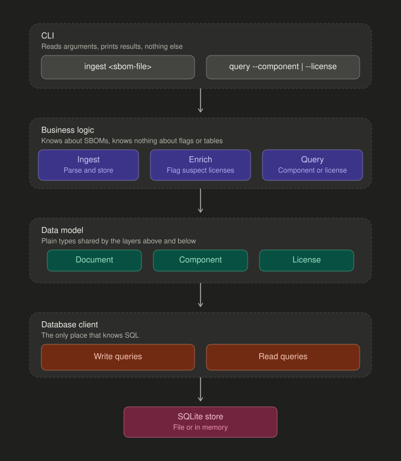
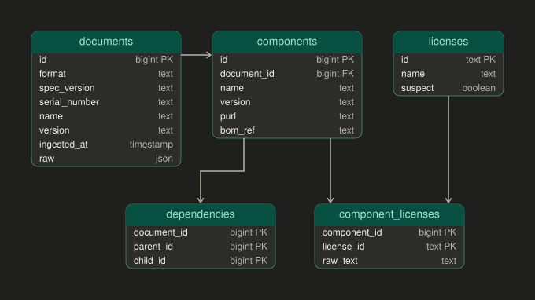

# Design guidelines

## Architecture

Four layers, each calling only the one below it.

- **CLI** turns arguments into one call to business logic and prints the result.
- **Business logic** owns ingest, enrich, and query. It never sees flags or SQL.
- **Data model** is a few plain types the layers on either side share.
- **Database client** is the only place SQL lives. It exposes named read and write functions.
- **SQLite store** sits outside the program. Swapping it touches one layer.

## Storage

Relational. Both queries cut across documents, so components and licenses become indexed rows and the original SBOM is kept beside them as JSON. See [sql-vs-nosql.md](sql-vs-nosql.md).

## Data model

- **documents** is one row per ingested SBOM, with the raw JSON kept so enrichment can be re-run.
- **components** is one row per component per document. Name, version, and purl are copied out for the queries to filter on.
- **licenses** is a small reference table keyed by SPDX id. The suspect flag is where enrichment lands.
- **component_licenses** joins the two, since a component may declare several licenses and an expression splits into several ids.
- **dependencies** holds the graph as edges. Neither query reads it.

Component lookup is an index scan on `components (name, version)` or on `purl`, then a join to `documents`. License lookup is an index scan on `component_licenses (license_id)`, then joins up to `components` and `documents`.

## Scale

Thousands of SBOMs with a thousand components each is single-digit millions of component rows, which is routine for Postgres. The two indexes above are the whole performance story. Past that:

- Make them covering indexes so lookups skip the heap.
- Ingest each document in one transaction with batched inserts, keyed on serial number and version so re-ingest is idempotent.
- Partition `components` by document id past tens of millions of rows. The license query crosses partitions, which is fine since it is index driven.
- Tracking SBOMs over time would split `components` into packages and occurrences. See [sql-vs-nosql.md](sql-vs-nosql.md).

## Out of scope

- SPDX 3.0. CycloneDX 1.6 only.
- The `dependencies` table. The graph stays in the raw JSON and nothing reads it.
- Nested components. The fixture has none.
- The full SPDX license list. `licenses` is seeded from a static lookup of a handful of licenses that are not open source or look suspect.
- Real expression parsing. Expressions are split on `OR`, `AND`, and parentheses.
- Idempotency. Re-ingesting the same file creates a new document row.
- Partitioning, batching, and covering indexes.
- Migrations. The schema is created on startup if it does not exist.
- Vulnerability data, pagination, and output formats beyond plain text.

## Decisions

Settled during the design session so the implementation plan does not have to choose.

| Topic | Decision |
|---|---|
| Test runner | `node:test`, built in. No test dependency. |
| TypeScript | Run `.ts` directly under Node 26. `tsc` is a type check only. |
| Fixture | The Juice Shop CycloneDX 1.6 file, 1,101 components, borrowed as is with its provenance note. |
| Enrichment | A static list of SPDX ids with a reason for each. Anything not on the list is not flagged. |
| Query output | One plain line per match. Component query prints document name and version. License query prints component name, version, and its document. |
| Database file | `./sbom.db` by default, overridable with `--db` on both commands. Tests pass `:memory:` through the same path. |
| Tests | Beside the source as `name.test.ts`. |
| Cadence | One commit at a time, pausing for a go-ahead after each. |
