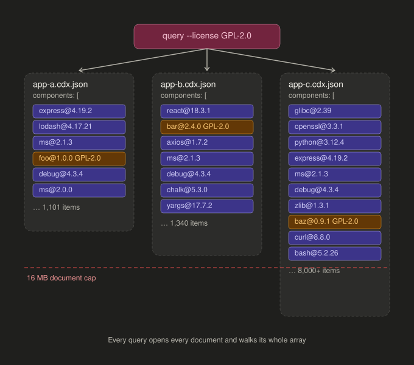

# SQL vs NoSQL

Should SBOMs live in a relational store like Postgres or a document store like Mongo? The question is about the theoretical scale of thousands of SBOMs and millions of components. Locally we use SQLite, which inherits the answer.

## What the data looks like

An SBOM is a natural document. One file holds metadata, a flat list of components, and a dependency graph. The fixture, a CycloneDX export of OWASP Juice Shop, shows what the list contains.

| Fact | Value |
|---|---|
| Components | 1,101 |
| Names that appear at more than one version | 117 |
| Distinct SPDX license ids | 11 |
| Components whose license is an expression such as `(MIT OR Apache-2.0)` | 7 |
| Components with no license | 10 |

Name alone does not identify a component. Name plus version does, and `purl` does globally. Licenses arrive in four shapes: a single id, several ids, an expression, or free text. A license query has to see through all four.

## What the queries look like

Both required queries ask about every document at once. Which documents contain component X? Which components carry license L? Neither starts from a document. They start from a component or a license and work back.

This is the case Martin Fowler describes for aggregate-oriented stores: they work when access follows the aggregate, and fall down when access cuts across it. Our access cuts across it.

## Tradeoffs

| Concern | Relational | Document |
|---|---|---|
| Ingest | Map JSON to rows. Keep the raw document in a JSON column | Store the file as is |
| Lookup by component | Index on name and version, and on purl | Index on an embedded array. Works, but a compound index may hold only one array field |
| Lookup by license | Join to a license table, or filter a copied column | Same array index limit. Expressions still need normalizing in code |
| Document size | Rows are independent | 16 MB cap per document. The 2 MB fixture suggests a few thousand components reaches it. Mongo calls this the unbounded array anti-pattern and advises referencing instead |
| Once you reference | This is the relational model | Tables rebuilt in a document store, with joins done by `$lookup` |
| Precedent | Dependency-Track v5 is Postgres only. GUAC supports only Postgres. GitLab's SBOM tables are Postgres | No SBOM platform found that chose a document store for search |

## Mongo Anti-pattern 

This is the shape Mongo's own guidance warns against. Each SBOM embeds its components as one array, every query walks every array, and the arrays grow without bound.

## The dimension of time

The charter's stretch goal asks when a component, or a vulnerable one, was introduced. That is a set difference between two documents in an application's history, and a join from component to vulnerability by package identity. Both are relational operations, so the requirement pushes the same way. It would also change the model: components would split into a package table keyed by purl and an occurrence table linking packages to documents, so vulnerability data attaches once per package. The exercise keeps the simpler shape, with components stored per document.

## Decision

Relational. Normalize identity, copy the hot filter columns, keep the raw document as JSON.

## Sources

- PostgreSQL, [JSON types](https://www.postgresql.org/docs/current/datatype-json.html). JSON suits data that is an atomic datum. A component is queried on its own, so it is not one.
- MongoDB, [Embedding vs references](https://www.mongodb.com/docs/manual/data-modeling/concepts/embedding-vs-references/) and [Unbounded arrays](https://www.mongodb.com/docs/manual/data-modeling/design-antipatterns/unbounded-arrays/). Reference when the child side has high cardinality or is queried on its own.
- MongoDB, [Multikey indexes](https://www.mongodb.com/docs/manual/core/indexes/index-types/index-multikey/). A compound multikey index may include at most one array field.
- OWASP, [Dependency-Track v5](https://owasp.github.io/blog/2026/06/09/dependency-track-v5.html). Postgres is the only supported database. Single instances hold over 250,000 SBOMs.
- OWASP, [Dependency-Track component model](https://github.com/DependencyTrack/dependency-track/blob/master/src/main/java/org/dependencytrack/model/Component.java). Components are rows per project with indexes on name and purl and a foreign key to a license table.
- Google and Kusari, [GUAC README](https://github.com/guacsec/guac/blob/main/README.md). Postgres is the only supported persistent backend.
- GitLab, [SBOM data model](https://gitlab.com/gitlab-org/gitlab/-/issues/364576). Component, version, and occurrence tables in Postgres.
- Martin Fowler, [Aggregate oriented database](https://martinfowler.com/bliki/AggregateOrientedDatabase.html). Aggregates work until you query across them.
